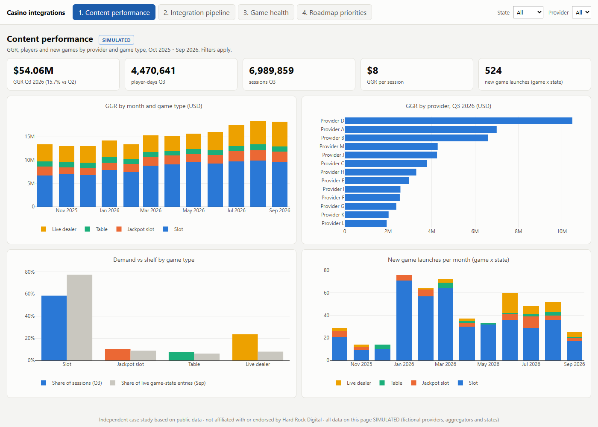

# Hard Rock Digital: a data-driven playbook for casino content integrations

Real US regulator data and certification rules, plus a simulated game catalogue and integration pipeline, turned into
requirements, compliance tracking, launch monitoring and a prioritised integration roadmap.

*Independent case study based on public data · not affiliated with or endorsed by Hard Rock Digital. Company facts come
only from Hard Rock Digital's own website and job posting; market figures are **PUBLIC DATA** from the New Jersey and
Pennsylvania regulators; every catalogue, provider, pipeline and player figure is **SIMULATED** (fictional providers
"A" to "T", "Aggregator X / Y", "State A, B, C") and is never presented as Hard Rock Digital data.*

- **Report (8 pages):** [docs/Hard_Rock_Digital_Casino_Integrations_Case_Study.pdf](docs/Hard_Rock_Digital_Casino_Integrations_Case_Study.pdf)
- **Interactive dashboard (one HTML file, works offline, 4 tabs, filters by state and provider):** [dashboard/casino_integrations.html](dashboard/casino_integrations.html)
- **Integration dossier (Provider Q onboarding):** [PRD](docs/integration/PRD_provider_onboarding.md) ·
  [15 user stories, Given/When/Then](docs/integration/user_stories.md) · [Jira backlog CSV](docs/integration/backlog.csv) ·
  [API integration checklist](docs/integration/api_integration_checklist.md) ·
  [compliance checklist](docs/integration/compliance_checklist.md) · [compliance tracker](docs/integration/compliance_tracker.csv)
- **Generated every week:** [integration status report](docs/status/weekly_status_2026-11-13.md) · [compliance alerts](docs/status/compliance_alerts.md)



## Four results
1. **Market (public data).** New Jersey online casino win reached **$3.16B** in the 12 months to September 2026,
   **+15%** year on year. The **"Hard Rock Bet"** skin, named in the DGE reports, took **6.5%** of it ($205M, **+41%**).
   In Pennsylvania, online slots bring 79% of online casino GGR and pay back 94.7% of wagers: the calibration point for
   the simulated catalogue.
2. **Launching a game (public rules + simulation).** Contract, wallet integration, QA, lab certification (GLI-19), then
   approval state by state. A new provider goes live in **~102 days** (P50) via an aggregator and **~168 days** direct.
   The slow state approves in 31 days vs 13-16 elsewhere: Provider N, approved in two states since July, still waits
   for the third. **Recommendation: launch it in the two approved states now.**
3. **Compliance and monitoring (simulated).** Weekly rules found **3 games live without approval** (P1), 2 supplier
   licences expiring within 60 days and 6 incomplete submission packages. After launch, volatility-aware RTP bounds keep
   **1 real problem out of 14 naive alarms** (a game deployed with the wrong RTP; the 89% vs 96% "scare" on a very
   volatile slot is normal variance). All **8 planted events** were found: a broken provider update (~$3.4k GGR lost a
   day), failed rollbacks, 30 duplicate games after an aggregator-to-direct switch, the novelty effect, a free-spin
   promotion measured against a hold-out (+$6.84 GGR per player, 1.8x its cost; a naive comparison claims 2.4x more).
4. **Roadmap (simulated).** Live dealer games earn 27% of GGR from 8% of the shelf. A transparent RICE-style score puts
   **Provider O (live dealer studio) first** in all one-at-a-time sensitivity cases and in 79% of 5,000 randomised
   runs, with **Provider R (jackpots, via an existing aggregator)** alongside; a large slot studio comes last.

## What is inside
```
data/public       derived PUBLIC DATA tables (NJ DGE, PA PGCB, Hard Rock Digital facts), with sources
data/simulated    SIMULATED catalogue, game_daily (parquet), pipeline, approvals, licences, wallet logs, promotions,
                  candidates, and _hidden_truth.csv: the answer key of the planted events, read only at the end of the
                  notebook to score detection (kept on purpose, clearly labelled)
data/output       SQL and notebook outputs
sql/              12 DuckDB files, commented: staging + data checks, content performance, life curve, pipeline cycle
                  time, wallet API, launch errors, RTP bounds, duplicates, aggregator vs direct, promotions,
                  compliance, KPIs (CTEs and window functions)
notebooks/        analysis.ipynb (built from analysis.py): market, catalogue health, pipeline Monte-Carlo, roadmap
                  score + sensitivity, promotion test, detection score
src/              download_data, simulate, run_sql, build_notebook, compliance_alerts, weekly_status, build_backlog,
                  build_dashboard, build_pdf, charts, run_all
docs/             PDF, page images, integration dossier, weekly status and alerts
dashboard/        casino_integrations.html
```

## Methods
- **KPIs:** GGR = wagers - player wins; realised RTP = player wins / wagers; margin after content fees = GGR x
  (1 - provider fee - aggregator fee); launch error rate; wallet technical error rate (timeouts, failed rollbacks;
  insufficient funds and idempotent replays are not errors); p95 latency.
- **RTP bounds:** over *n* rounds the realised RTP moves around the theoretical one by about sd per round / sqrt(n);
  z = (wins - RTP x wagers) / (sd x bet x sqrt(rounds)); watch beyond 3, escalate beyond 4 (about 500 games are checked
  each week, so a lone 3-sigma rule would raise a false alarm every week or two).
- **Monitoring rules:** each provider vs its own trailing 28-day baseline (window function); rollback failures above 2%.
- **Forecasts:** Monte-Carlo (10,000 runs) with log-normal stage durations fitted on finished stages; stages already
  open are drawn conditional on their age; P50 to plan, P80 to commit externally.
- **Roadmap:** RICE-style score = Impact x Confidence / Effort, with Reach and the launch date inside Impact;
  one-at-a-time and randomised sensitivity.
- **Promotion:** randomised 10% hold-out, Welch t-test and 95% confidence intervals, CUPED check.
- **Responsible gaming** is written in as normal requirements (limits, time-outs, self-exclusion, reality checks,
  RG review of promotions), not as an afterthought.
- **AI note.** AI-assisted workflow: I used Claude, mainly to write scripts faster. I drove the project: I defined the questions, chose and validated the data sources, made the analytical decisions and checked every result.

### Automation, and where an AI assistant fits
- `src/weekly_status.py` writes the Friday integration status (what moved, what is blocked, risks, P50/P80 launch dates,
  post-launch health) from the tracker and the data: no copy-paste into a deck.
- `src/compliance_alerts.py` raises P1 (live without approval), P2 (licence expiring) and P3 (missing documents) alerts
  and refreshes the onboarding tracker. `src/build_backlog.py` turns the user stories into the Jira CSV.
- With an AI assistant I would draft first versions of user stories, acceptance criteria, API checklists and release
  notes from a provider's documentation, then review and validate every line with Engineering and Compliance.
  I would **not** automate compliance decisions, go/no-go calls or anything sent to a regulator.

## Rebuild
```bash
python -m venv .venv
.venv/Scripts/pip install -r requirements.txt
.venv/Scripts/python src/run_all.py
```
Or step by step:
```bash
python src/download_data.py      # regulator files -> data/raw (not committed) -> data/public
python src/simulate.py           # SIMULATED tables, seed 42
python src/run_sql.py            # the 12 SQL files -> data/output
python src/build_notebook.py     # executes notebooks/analysis.ipynb
python src/compliance_alerts.py  # alerts + compliance tracker
python src/weekly_status.py      # weekly status report
python src/build_backlog.py      # user stories -> Jira CSV
python src/build_dashboard.py    # dashboard/casino_integrations.html
python src/build_pdf.py          # PDF via headless Microsoft Edge (Windows)
```

## Sources
- Hard Rock Digital home page, https://www.hardrockdigital.com/ (read 15 Nov 2026); job posting "Product Analyst -
  Casino Integrations", https://himalayas.app/companies/hard-rock-digital/jobs/product-analyst-casino-integrations
  (posted 8 Nov 2026).
- New Jersey Division of Gaming Enforcement: Monthly Internet Gaming Gross Revenue Reports, Oct 2024 - Sep 2026;
  Internet Gaming Sites; Slot Laboratory - Technical Services Bureau; Internet Gaming Information (N.J.A.C. 13:69O).
- Pennsylvania Gaming Control Board: Monthly Interactive Gaming Report, FY 2025-26 and FY 2026-27.
- Gaming Laboratories International: GLI-19 v4.0, GLI-11 v3.0, Composite Submission Requirements v2.0, Change
  Management Program Guide v1.0.

Details and reuse notes: [data/SOURCES.md](data/SOURCES.md). Simulation assumptions: [data/ASSUMPTIONS.md](data/ASSUMPTIONS.md).

## Limits
- All operator, provider, pipeline and player data is simulated and calibrated on public orders of magnitude: it shows
  methods, not Hard Rock Digital's catalogue, partners, licences or results.
- Regulator figures are revenue (win / GGR) as reported, without adjustment for promotional credits or taxes.
- The compliance checklist summarises public documents; it is not legal advice, and each state has its own rules.
- The roadmap elasticities and effort estimates are assumptions; the sensitivity analysis is there to test them.
